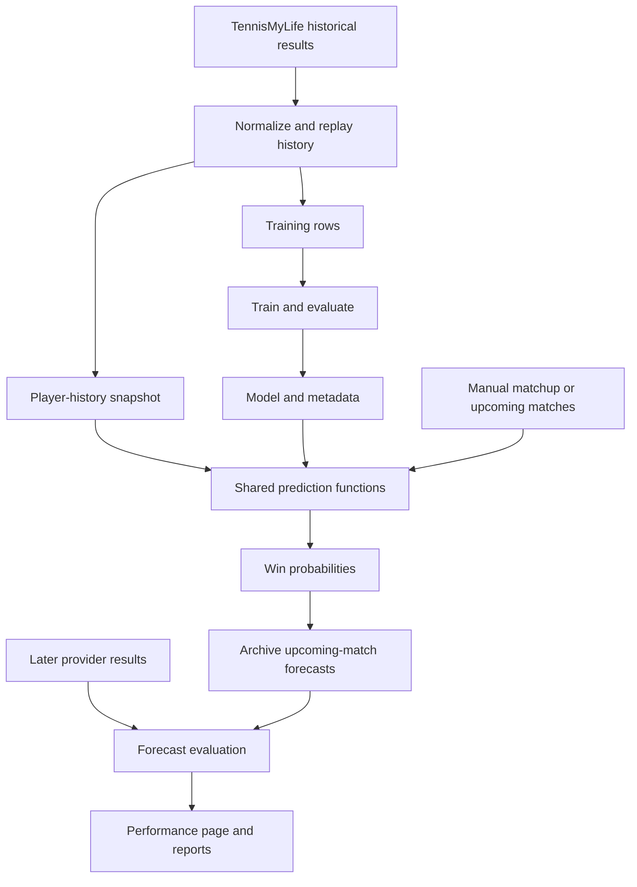

# A plain-language walkthrough of the tennis prediction code

This guide follows the source code reviewed on November 8, 2026. It explains the production package, its supporting tools, and the rules that matter when changing it. Examples of probabilities are illustrative, not measured model results.

## 1. What this project does

The application estimates who will win an ATP tennis match. You supply two players, a surface, and a future date. It looks up what it knows about each player, compares them, and passes those comparisons to a trained classifier.

There are five connected activities:

1. Collect historical match results.
2. Replay those results to build player histories and training examples.
3. Train and evaluate a model.
4. Make manual or upcoming-match predictions.
5. Compare saved upcoming-match predictions with later results.

The web application is the interface to these activities. Most of the calculation lives in reusable Python modules behind it.



Evidence: `src/tennis_match_prediction/pipelines/historical_matches/assets.py`, `ml/experiment.py`, `ml/predict.py`, `web/upcoming.py`, and `forecast_evaluation/service.py` under that package.

## 2. The vocabulary, without the jargon

| Term | Meaning here |
| --- | --- |
| DataFrame | A table in memory, with rows and named columns. |
| Feature | A number the model receives, such as the difference between two Elo ratings. |
| Target | The answer attached to a training example: which player won. |
| Training | Learning a relationship between features and targets. |
| Inference | Using an already trained model to calculate a probability. |
| Asset | A named data product Dagster knows how to build. |
| Materialize | Run the code that produces an asset. |
| Contract | A definition of valid fields, types, or table contents. |
| Artifact | A saved output, such as a model or history snapshot. |
| Hash | A fingerprint of file contents, used to identify the exact version. |
| Leakage | Giving training or evaluation information that would not have been available before the match. |

CSV is the readable table format used for exports. Parquet is a binary table format used for intermediate data and history storage. JSON holds structured metadata and reports. A pickle holds the Python model object.

## 3. The directory map

The installed package lives in `src/tennis_match_prediction/`. The folders divide responsibilities:

| Folder or file | What to expect |
| --- | --- |
| `contracts/` | Valid inputs, player state, dataset rules, feature names, and model settings. |
| `transforms/` | Functions that clean data, replay history, calculate features, and build training rows. |
| `pipelines/historical_matches/` | Downloads, Dagster assets, quality checks, and validated history publication. |
| `pipelines/model_training/` | A Dagster entry point to the same model-training code used by the CLI. |
| `pipelines/shared/` | Parquet persistence and asset metadata helpers. |
| `ml/` | Dataset splitting, models, training, evaluation, artifacts, tracking, and prediction. |
| `web/` | FastAPI endpoints, player/model services, upcoming forecasts, and browser files. |
| `forecast_evaluation/` | Result collection, forecast eligibility, metrics, and reports. |
| `workflows/` | The daily maintenance coordinator. |
| `providers/` | Shared Live Tennis API configuration. |
| `storage/` | Shared atomic JSON writing. |
| `diagnostics/` | Explicit provider experiments, separate from the normal application flow. |
| `paths.py` | Default data locations and environment configuration. |

At repository level, `tests/` contains regression tests, `notebooks/` contains exploration, `docs/` contains explanations, and `docker/` contains the optional MLflow tracking-server setup. `workspace.yaml` tells Dagster which Python definitions to load.

Evidence: `workspace.yaml`, `paths.py`, and the source folders listed above. The seven documents in `docs/codebase/` give a more compact reference by topic.

## 4. The three files to distinguish first

Three published outputs have different jobs:

| Output | Meaning | Main consumer |
| --- | --- | --- |
| `data/curated/curated_atp_matches.csv` | Cleaned historical rows, retaining winner/loser names for inspection. | Inspection and training-row construction upstream of export. |
| `data/curated/training_atp_matches.csv` | Player-oriented examples containing features and the answer. | Model training. |
| `data/curated/player_history.parquet` | Accumulated player states after replaying the available history. | Future prediction and player profiles. |

The player-history Parquet contains a one-row table whose `history` cell is a serialized `PlayerHistory` JSON object. It is not a normal table with one player per row.

A trained `model.pkl` is another, separate output. It stores the learned relationship between comparisons and outcomes. The history snapshot stores the current inputs needed to make those comparisons.

For example, a new result can change a player's Elo and recent form. Rebuilding history makes those changes available to an existing model. Retraining is a separate decision.

Evidence: `pipelines/historical_matches/assets.py`, `pipelines/shared/parquet_io.py`, `contracts/player_history.py`, and `ml/artifacts.py`.

## 5. Step one: collect historical results

Start with `pipelines/historical_matches/config.py`. Its `RawMatchesCsv` class manages the source files.

It queries the TennisMyLife file catalog, chooses annual ATP CSVs, downloads them, validates required columns, records hashes, and consolidates the locally available seasons into `all_atp_matches.csv`.

Two selectors have different meanings:

- `years=[2025, 2026]` chooses which seasons to download. Other local seasons still participate in consolidation.
- `first_year=2020` selects an open-ended range and also excludes older cached seasons from consolidation and the raw asset.

The code rejects using both selectors together. `refresh=True` is the resource default. With refresh disabled, the raw asset can reuse the consolidated CSV or consolidate existing annual files if needed.

There is also an optional ongoing-results feed. It preserves observed partial results and reconciles them with annual rows using tournament ID and match number, checking the participants. Annual records take precedence. Conflicting identities stop the update rather than guessing.

Disappearing from a partial feed does not establish that a result should be deleted. This distinction matters because a partial feed is not a complete historical archive.

Evidence: `RawMatchesCsv.download_seasons`, `_download_ongoing`, `load_seasons`, and `raw_atp_matches` in `pipelines/historical_matches/assets.py`.

## 6. Step two: build the historical dataset

`pipelines/historical_matches/assets.py` describes the main chain:

```text
raw_atp_matches
  -> normalized_atp_matches
  -> player_comparison_atp_matches
  -> curated_atp_matches
  -> training_atp_matches
  -> training_atp_matches_csv
```

There are two side outputs: `player_history` branches from the comparison step, and `curated_atp_matches_csv` branches from the curated step. Building training rows does not require first writing the curated CSV.

**Normalization** removes walkovers and rows without player IDs, cleans surfaces, parses dates, orders matches, and retains source attributes without expanding seeds or entry methods.

**Comparison generation** replays player history and calculates the 12 shared pre-match features. It also produces the final player-history snapshot.

**Curation** validates the shared comparisons and removes per-match outcome statistics. It retains source context without categorical encoding or attribute imputation. The current match's serving statistics update history only after its features have been calculated.

**Training-row construction** assigns neutral player positions, orients the 12 comparison features, and creates the binary target. The output contains exactly those features, `tourney_date`, and `winner` (14 columns).

Dagster's IO manager writes intermediate DataFrames to Parquet. Asset checks cover required columns, chronology, walkovers, finite comparison features, target validity, and the exact output schema. The refresh wrapper explicitly requires successful execution and checks before publication.

Evidence: `pipelines/historical_matches/{assets,checks,defs}.py`, `pipelines/shared/parquet_io.py`, and `transforms/{normalization,curation,elo,training_rows}.py`.

## 7. The central rule: calculate first, learn the result afterward

`transforms/temporal_features.py` contains the core replay logic. A simplified version is:

```python
for batch in chronological_batches:
    prior_state = remember_players_before_this_batch()
    for match in batch:
        features[match] = compare_players(prior_state, match)
    for match in batch:
        update_players_with_result(match)
```

Imagine Alice has won six of her last ten matches before facing Bea. Her recent-form input for this match must use those ten previous matches. If Alice wins today, that win becomes part of her state only after today's feature vector has been calculated.

The real implementation first creates state for previously unseen players. It computes every comparison in the batch before mutating history lists or head-to-head counts, then applies results using pre-batch ratings and counts.

Why batches? The historical source does not always identify actual match dates or start times. `tourney_date` can describe a tournament's start date. Numeric match numbers can establish order within a tournament; lexical tournament IDs cannot establish real chronology across events.

`transforms/match_preparation.py` therefore groups matches with ambiguous ordering into batches; `transforms/temporal_features.py` freezes the prior state for each batch. Missing, invalid, or duplicate match numbers can make a tournament group ambiguous. A player appearing in different tournaments on the same source date makes that date ambiguous. Comparisons in the resulting batch share the same prior state.

This policy reduces leakage from uncertain ordering. It does not reconstruct official match timestamps.

Player state includes overall and surface Elo, wins/losses, name-keyed head-to-head wins, the latest 50 overall results, the latest 10 results per surface, serving totals, and the last valid observed rank, ranking points, and age. These counts describe the ingested history; a restricted source range is not necessarily a complete career.

Elo starts at 1500. Its update compares the actual result with the expected result, using a factor that decreases with accumulated match count. Overall and surface ratings share the update formula.

Evidence: `transforms/match_preparation.py`, `transforms/temporal_features.py`, `transforms/elo.py`, and `contracts/player_history.py`.

## 8. The 12 model inputs

The canonical names are in `contracts/features.py`. Their formulas are in `transforms/player_comparison.py`. The default selection and ordering are in `ml/config.py`.

Most differences are player1 minus player0:

| Feature | Plain-language meaning |
| --- | --- |
| `overall_elo_diff` | Difference in overall Elo strength. |
| `surface_elo_diff` | Difference in Elo on the requested surface. |
| `rank_log_advantage` | Ranking comparison, reversed because a smaller rank number is better. |
| `points_log_diff` | Difference in log-transformed ranking points. |
| `form_10_diff` | Difference in win rate over up to ten recent matches. |
| `surface_form_10_diff` | Difference in win rate over up to ten recent matches on this surface. |
| `age_diff` | Difference in last observed age. |
| `h2h_log_odds` | Smoothed log ratio of head-to-head wins. |
| `experience_log_diff` | Difference in log-transformed accumulated match counts. |
| `ace_rate_diff` | Difference in historical aces per service point. |
| `double_fault_rate_diff` | Difference in historical double faults per service point. |
| `service_points_won_diff` | Difference in historical service-points-won rates. |

For Elo values of 1800 and 1900, `overall_elo_diff` is `1900 - 1800 = 100`. Swapping players makes it `-100`.

The ranking feature is `log(1 + rank0) - log(1 + rank1)`. The points and experience features use `log(1 + value1) - log(1 + value0)`. Logarithms compress large differences. Head-to-head uses `log((wins1 + 1) / (wins0 + 1))`; adding one keeps the calculation defined when there are no previous meetings.

Positive does not universally mean better: a positive double-fault difference means player1 double-faults more, and an age difference is not intrinsically an advantage. The model learns how the inputs relate to winning.

If either side lacks an observation for a comparison, the shared difference helper returns zero. This represents a neutral comparison, not evidence that both players have equal ability. Serving-rate totals use a separate valid denominator for each statistic, so missing ace observations do not silently count as observed zero aces.

Surface affects surface Elo and form. The future date is checked against the history cutoff; it does not project future age, rankings, or form. With the same players, surface, model, and history, changing only the allowed date leaves the features unchanged.

Evidence: `contracts/features.py`, `transforms/player_comparison.py`, `transforms/temporal_features.py`, and `ml/predict.py`.

## 9. Why training uses player0 and player1

Raw historical data calls the participants winner and loser. Keeping those roles as model input positions would reveal the answer.

`build_training_rows()` randomly assigns the participants to `player0` and `player1`, with seed 42 in the Dagster asset for reproducibility. It changes the signs of the comparison features when necessary, and creates this target:

```text
winner = 1  means player1 won
winner = 0  means player0 won
```

For example, a winner-minus-loser Elo difference of `+100` stays `+100` if the winner becomes player1. It becomes `-100` if the winner becomes player0. The target changes with the same assignment.

Names and IDs are excluded from the final training rows. This prevents using identity columns directly as model inputs. Randomizing player positions is different from randomly shuffling time periods: the dataset split remains chronological.

Evidence: `transforms/training_rows.py` and `training_atp_matches` in `pipelines/historical_matches/assets.py`.

## 10. Step three: train a model

`ml/train.py` is the public Python and command-line entry point. It builds an `ExperimentConfig` and calls `ml/experiment.py:run_experiment()`.

That runner:

1. Creates the requested model through `ml/models/factory.py`.
2. Loads and validates the published training CSV through `ml/dataset.py`.
3. Opens experiment tracking and saves configuration and provenance.
4. Fits the model on the training period.
5. Scores validation, and optionally the final test period.
6. Saves the model, metadata, and tracking artifacts.

The default periods are:

| Period | Source dates | Purpose |
| --- | --- | --- |
| Warmup | Before January 1, 2017 | Build earlier player history; excluded from fitting. |
| Training | January 1, 2017 through December 31, 2023 | Fit model parameters. |
| Validation | Calendar year 2024 | Assess candidate configurations. |
| Test | January 1, 2025 onward | Final evaluation when explicitly requested. |

The boundaries are configurable. The loader requires every period to contain rows and the training period to contain both target classes. Test metrics are calculated only with `--final-evaluation`; that flag does not add validation or test rows to fitting.

Available adapters are logistic regression, random forest, Extra Trees, histogram gradient boosting, and XGBoost. They expose the same `fit`, `predict_proba`, and `get_params` interface. Logistic regression includes a `StandardScaler` fitted inside its training pipeline. The tree models use their estimator adapters without that scaler. XGBoost uses fixed iterations rather than fitting against validation/test targets for early stopping.

The shared probability interface always returns `P(player1 wins)`, explicitly looking up class 1 in the estimator's class order.

Three metrics are recorded: accuracy measures winner picks; Brier measures squared probability error; log loss penalizes confidently wrong probabilities. Lower Brier and log loss are better. Ranking, overall Elo, and surface Elo winner-picking baselines provide reference accuracies; neutral baseline comparisons receive half credit.

Evidence: `ml/{train,experiment,dataset,evaluation,config}.py`, `ml/models/`, and `contracts/{experiments,model_settings}.py`.

## 11. What training saves

Each default run gets a unique folder under `data/models/`. It includes `model.pkl`, matching `model.json`, and a provenance directory. Explicit output paths cannot overwrite an existing experiment pair.

The pickle contains the model and metadata. The JSON provides readable metadata: model name, ordered features, target convention, history-order convention, split information, dataset hash, parameters, metrics, provenance, and tracking identifiers.

`ml/tracking.py` supports server, local, and disabled tracking. Local mode uses SQLite and local artifacts; the optional Docker stack runs MLflow with PostgreSQL and an artifact volume. The server is for experiment records and artifacts, not the application's player database.

The web application can also resolve a registered MLflow model by alias or version. It downloads the originating finished run's project pickle and matching JSON once at startup. Registry changes require restarting to select the new version. Serving predictions does not require an MLflow request per prediction.

Model loading uses Python pickle, so the implementation assumes trusted project artifacts. Registry selection validates readiness and provenance but does not automatically register or promote models.

Evidence: `ml/artifacts.py`, `ml/experiment.py`, `ml/tracking.py`, `web/registry.py`, `docker-compose.yaml`, and `docker/mlflow/`.

## 12. Step four: make one prediction

Read `ml/predict.py` in this order:

1. `predict()` loads a model and history snapshot.
2. `features_for()` resolves each CLI name to exactly one history player, ignoring case.
3. `features_for_players()` validates the date, distinct IDs, player existence, and surface.
4. `calculate_player_comparison()` produces the same formulas used in training.
5. `probability_for()` selects features in the model metadata's saved order and scores them.

The prediction date must be strictly after `last_source_date`. Supported surfaces are Hard, Clay, Grass, and Carpet. Missing or ambiguous names are errors.

If a model returns `0.62`, the response gives player1 a 62% probability and player0 38%. The web service also calculates fair decimal odds as `1 / probability`: approximately 1.61 and 2.63. These odds have no bookmaker margin. A zero probability is represented by an unavailable JSON odds value and can be displayed as infinite odds.

The model may use a subset of the shared features. A model requiring inputs that inference cannot generate is incompatible. The web discovery service filters such models, and the scoring function checks for missing features.

Historical as-of prediction is not implemented. A final snapshot cannot safely answer what the system would have predicted before an earlier match.

Evidence: `ml/predict.py`, `contracts/prediction.py`, and `web/service.py`.

## 13. How the web application works

`web/__main__.py` parses startup options and starts Uvicorn. `web/app.py:create_app()` builds the FastAPI application and serves HTML, JavaScript, and CSS from `web/static/`. There is no separate frontend framework or Node build step in this implementation.

`PlayerService` loads and validates history, builds a normalized name-search index, discovers compatible models, and caches loaded model objects. The browser selects stable history IDs for manual predictions. Search is tolerant of accents and punctuation; that search behavior is separate from the CLI's exact case-insensitive name lookup.

The principal endpoints are:

| Endpoint | Purpose |
| --- | --- |
| `GET /api/status` | History version, freshness, players, and model choices. |
| `GET /api/players` | Search and page through players. |
| `GET /api/players/{player_id}` | Read a player profile. |
| `POST /api/predict` | Score a manual matchup. |
| `GET /api/upcoming` | Read the saved upcoming batch. |
| `POST /api/upcoming/refresh` | Fetch upcoming matches and generate a batch. |
| `GET /api/upcoming/batches/{batch_id}` | Download a saved batch. |
| `GET /api/performance` | Read the published forecast report. |
| `GET /api/performance/download` | Download its Markdown representation. |

`static/app.js` manages page state, API calls, player selection, profiles, results, upcoming matches, and performance filters. Sequence counters prevent older asynchronous responses from replacing a newer user selection. `index.html` supplies the page structure; `style.css` supplies the presentation.

HTML requests require cache revalidation. JavaScript/CSS URLs contain content hashes, which help browsers load assets matching the deployed HTML.

On API requests, the application checks `latest_refresh.json`. If it changes, it loads the referenced immutable history snapshot and verifies its hash before replacing the in-memory service. A failed reload keeps the previous snapshot and exposes an error in status. Adding models normally requires a restart; refreshing published history does not.

The default local model is the most recently modified compatible artifact discovered, not necessarily the most accurate. The CLI currently binds Uvicorn to `0.0.0.0`, although the README describes localhost-only operation. The route implementation has no authentication layer.

Evidence: `web/{__main__,app,service,contracts}.py` and `web/static/{app.js,index.html,style.css}`.

## 14. Upcoming matches and reproducible batches

`web/upcoming.py:UpcomingService` requests upcoming ATP singles main-draw matches from Live Tennis API. The request budget is five pages of up to 100 rows; the source response is cached for one minute. An incomplete page sequence or provider error prevents publishing a replacement batch.

Before predicting, it checks the match status, future timezone-aware scheduled time, known surface, and distinct participants. Postponed, cancelled, started, missing, and ambiguous cases are skipped with recorded reasons.

Provider players are mapped to historical players through a unique normalized full name. Provider IDs are retained for later result reconciliation; they are not assumed to equal historical IDs. There is no fuzzy name matching or alias guessing.

A saved batch contains:

```text
data/predictions/<batch-id>/
  batch.json
  source.json
  model.pkl
  model.json
  player_history.parquet
```

The copied files are the exact frozen inputs used for prediction, including a model downloaded temporarily from the registry. The batch ID depends on source content, model/history identity, predictions, and skip decisions, while excluding generation timestamps from the prediction identity. An identical batch reuses its saved directory.

Reading a batch makes no provider call. The current view hides matches after their scheduled start and hides batches incompatible with the current model/history. The archived directory remains available on disk.

Evidence: `web/upcoming.py`, `web/service.py:save_prediction_artifacts`, and `web/__main__.py`.

## 15. Step five: evaluate forecasts after the matches

Training validation asks how a model performs on historical examples. `forecast_evaluation/` asks how archived predictions performed after they were actually issued.

`service.py` reads saved batches, finds matches whose original scheduled time has passed, and collects provider results with a maximum of 20 requests per execution. It revisits older observations, including completed results, so corrections can produce a new report.

`reconciliation.py` checks the provider match ID and both participant IDs. If the provider reverses participant order, the winner is translated using IDs. A name resemblance or approximate date is not enough.

An evaluated forecast must also pass strict timing checks: source collection and prediction creation precede the original schedule, the result's schedule, and `live_at`; the result observation follows the required times; and the history source date is before the UTC cutoff day. All those timestamps must be available with timezones. `live_at` remains a provider observation, not proof of an official start time.

Only completed matches with a completed outcome and explicit winner are scored. Retirements, walkovers, defaults, cancellations, unresolved outcomes, and unproven timing are excluded or remain pending. When several eligible forecasts exist for the same match and exact model version, only the latest counts. Every decision remains in the report.

`metrics.py` calculates accuracy, Brier, log loss, history lag, and descriptive probability bins. Reports also expose coverage and per-surface metrics. No eligible results produces null metrics, not a claim of zero error.

Every run writes `results.json`, `report.json`, and `report.md` in a new `data/performance/runs/<id>/` directory before updating `latest.json`. Old reports and predictions remain unchanged. Offline evaluation reuses saved observations.

Manual prediction exports do not carry a provider match identity and are outside this evaluation flow. Different model versions can cover different match samples, so the report alone is not a controlled model comparison.

Evidence: `forecast_evaluation/{service,reconciliation,metrics,reporting,archive,details}.py`.

## 16. Daily maintenance and publication

`workflows/daily_update.py` coordinates two independent stages: history refresh and forecast evaluation. It still attempts the second if the first fails, saves an operational report, and reports overall failure if either stage fails.

By default it refreshes the current and previous seasons, includes ongoing results, and preserves other local seasons. It does not train models or generate new upcoming forecasts.

`pipelines/historical_matches/refresh_history.py` makes a frozen source copy, computes source and implementation fingerprints, and checks the existing outputs. If inputs, implementation/dependencies, and intact output hashes agree with the previous publication, it skips the expensive rebuild. When needed, it fully replays history in an isolated attempt directory.

Only a successful run with passing checks is published. The three compatibility exports are replaced individually, then `latest_refresh.json` points to the validated snapshot set. The web reader uses that pointer. Direct readers of the CSV exports should wait for successful completion because replacing three separate files is not one transaction.

Lock files prevent overlapping operations at the relevant directories. Retained snapshots and prediction copies support reproducibility but consume disk space.

`pipelines/daily_update.py` exposes this workflow as a Dagster job and a schedule for 06:00 in `America/Sao_Paulo`. A running Dagster daemon and an enabled schedule are needed for scheduled execution. `pipelines/defs.py` merges the historical, training, and daily definitions loaded by `workspace.yaml`.

Evidence: `workflows/daily_update.py`, `pipelines/daily_update.py`, `pipelines/defs.py`, and `pipelines/historical_matches/refresh_history.py`.

## 17. Contracts, configuration, and diagnostics

`contracts/base.py:ContractModel` rejects unknown fields and non-finite numeric values. Other contract modules specialize this for experiments, model parameters, requests, history, ingestion metadata, and DataFrames. DataFrame checks validate the relevant columns, dates, numeric values, and binary targets.

`paths.py` loads dotenv configuration and defines the data locations. `TENNIS_DATA_DIR` changes the data root; `TENNIS_RAW_MATCHES_CSV` changes the consolidated source path. `.env.example` documents MLflow, Dagster, provider-key, and web-registry settings. Private `.env` contents are not needed to understand the code.

`ml/feature_quality.py` inspects raw source coverage. It distinguishes missing values, invalid observations, and valid zero values by season. That reveals gaps that neutral comparison values in the training table can hide.

`diagnostics/live_tennis_probe.py` is an explicitly run provider investigation. Normal forecast generation uses `web/upcoming.py`; production result evaluation uses `forecast_evaluation/`.

Evidence: `contracts/`, `paths.py`, `.env.example`, `ml/feature_quality.py`, and `diagnostics/live_tennis_probe.py`.

## 18. How to run the main flows

Use Python 3.12 and uv. Run these commands from the repository root. They describe available operations; this walkthrough review did not download source data or train a new model.

Install dependencies:

```powershell
uv sync
```

Configure `.env` from `.env.example` if it does not already exist. Set `DAGSTER_HOME` for your checkout when using the Dagster instance. Choose local tracking or a reachable MLflow server for training.

Build history, including initial annual downloads:

```powershell
uv run python -m tennis_match_prediction.pipelines.historical_matches.refresh_history
```

Rebuild from existing local input without downloading:

```powershell
uv run python -m tennis_match_prediction.pipelines.historical_matches.refresh_history --local-only
```

Train using local MLflow storage:

```powershell
uv run python -m tennis_match_prediction.ml.train --tracking-mode local
```

Start the web interface, then open `http://127.0.0.1:8000`:

```powershell
uv run python -m tennis_match_prediction.web
```

Predict by CLI, replacing the example model path and choosing a date after the history cutoff:

```powershell
uv run python -m tennis_match_prediction.ml.predict "Carlos Alcaraz" "Jannik Sinner" 2027-01-01 Hard --model-path "data/models/<experiment-id>/model.pkl"
```

Run daily maintenance, or evaluate only saved results without provider calls:

```powershell
uv run python -m tennis_match_prediction.workflows.daily_update
uv run python -m tennis_match_prediction.forecast_evaluation --offline
```

Open Dagster to inspect the data graph:

```powershell
uv run dagster dev
```

The optional tracking stack uses the actual checked-in Compose filename:

```powershell
docker compose -f docker-compose.yaml up -d --build --wait
```

Evidence: the module parsers in `ml/train.py`, `ml/predict.py`, `web/__main__.py`, `workflows/daily_update.py`, `forecast_evaluation/__main__.py`, and `pipelines/historical_matches/refresh_history.py`; `docker-compose.yaml`; `workspace.yaml`.

## 19. How the tests protect the important behavior

Tests live in `tests/test_*.py` and use pytest. The suite covers ingestion, temporal ordering, player state, comparison formulas, training-row orientation, contracts, models, baseline metrics, prediction, web routes, batch archives, daily maintenance, and prospective evaluation.

Temporary directories isolate outputs; monkeypatch replaces environment settings and external calls. Web tests use FastAPI's `TestClient`. Optional MLflow HTTP and Docker integration checks require their explicit environment flags.

The GitHub Actions workflow runs pytest, validates Dagster definitions, runs Ruff on `src` and `tests`, and runs Pylint on the pipeline package. A line/branch coverage threshold is not configured in the reviewed workflow or manifest.

Useful commands:

```powershell
uv run pytest -q
uv run pytest tests/test_player_history.py tests/test_player_comparison.py tests/test_training_rows.py -q
uv run ruff check src tests
```

For a feature change, the most valuable question is whether the historical path and future-prediction path still compute the same meaning and orientation. For a chronology change, inspect the ambiguous-order tests as well as the happy path.

Evidence: `pyproject.toml`, `.github/workflows/pylint.yml`, and `tests/`.

## 20. Limits to keep in mind while reading or changing the code

- History contains source dates, not a reconstructed official match timeline.
- Latest-state prediction cannot answer past as-of questions.
- Refreshing player state does not retrain or promote a model.
- The training export is wider than the default model's 12 inference-compatible features.
- Missing comparisons can become neutral zero, hiding the distinction between unavailable data and equal observed values.
- Provider-to-history mapping currently depends on unique normalized full names. Head-to-head state is also keyed by opponent name.
- Profile result history stores result, surface, and source date; it does not store a full opponent/score match log.
- Changing a permitted future date does not simulate changes in player condition.
- Reported probabilities have not been established as calibrated. Probability bins in performance reports are descriptive.
- Full replay, retained snapshots, and per-batch model/history copies have runtime and storage costs.
- The README contains stale statements about localhost binding, restart requirements, ongoing ingestion, and the Compose filename. The source paths cited here establish the behavior described in this walkthrough.

Evidence: `ml/predict.py`, `transforms/{match_preparation,player_comparison,temporal_features}.py`, `contracts/player_history.py`, `web/{__main__,service,upcoming}.py`, `workflows/daily_update.py`, `forecast_evaluation/{reconciliation,metrics}.py`, and `README.md`.

## 21. A practical reading order

Read `contracts/player_history.py` to understand what is remembered about a player. Then read `transforms/player_comparison.py` to see how two players become 12 numbers. Next, read `transforms/temporal_features.py` and `transforms/match_preparation.py` to see how those numbers stay chronological.

Continue with `transforms/training_rows.py`, `ml/dataset.py`, and `ml/experiment.py` to understand how historical comparisons become a fitted model. Then read `ml/predict.py` to see the same comparisons used for a future matchup.

Finally, read `web/service.py`, `web/upcoming.py`, `forecast_evaluation/reconciliation.py`, and `workflows/daily_update.py`. Those modules turn the prediction functions into an application with saved forecasts, observed results, and repeatable maintenance.
